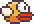

# Flappy Bird com IA evolutiva (NEAT)

Versão do jogo Flappy Bird em Python e Pygame em que uma população de redes neurais aprende a jogar sozinha, evoluindo geração após geração com o algoritmo NEAT (NeuroEvolution of Augmenting Topologies).

## Problema que resolve e para quem

Mostra, de forma visual, como funciona a neuroevolução: em vez de treinar uma rede com exemplos rotulados, o NEAT cria uma população de redes, avalia cada uma pelo desempenho no jogo (fitness) e combina e muta as melhores para formar a próxima geração. É útil para estudantes e entusiastas de inteligência artificial que querem ver um algoritmo genético aprendendo em tempo real, e serve de base para experimentar parâmetros de evolução no arquivo de configuração.

## Tecnologias utilizadas

- Python
- Pygame (jogo, sprites, colisão por máscara e sons)
- neat-python (evolução das redes neurais)

## Como funciona

- Cada geração tem uma população de 50 genomas (`pop_size` em `src/game/configs.txt`); cada genoma controla um pássaro.
- A rede recebe 3 entradas — a altura do pássaro e a distância vertical até o cano de cima e até o cano de baixo — e tem 1 saída com ativação `tanh`; se a saída passa de 0,5, o pássaro pula.
- Fitness: +0,1 a cada quadro vivo, +5 por cano ultrapassado e −1 ao bater em um cano. A velocidade e a distância entre os canos aumentam a cada ponto.
- A evolução roda por até 100 gerações ou até um genoma atingir fitness 1000 (`fitness_threshold`). A tela mostra a pontuação e a geração atual; o terminal mostra as estatísticas de cada geração.

## Como executar

Pré-requisitos: Python 3 e pip.

```bash
git clone https://github.com/FelipeGA02/Flappy-Bird-AI.git
cd Flappy-Bird-AI
pip install -r requirements.txt

# rode a partir da raiz do repositório: as imagens e sons são carregados de ./assets
python src/game/FlappyBird.py
```

O arquivo de configuração do NEAT (`src/game/configs.txt`) é localizado a partir da pasta do próprio script, mas a pasta `assets/` é lida por caminho relativo ao diretório atual; por isso o comando deve ser executado na raiz do repositório.

Para jogar manualmente (barra de espaço para pular), mude `ai_playing = True` para `ai_playing = False` no início de `src/game/FlappyBird.py`.

## Minha contribuição

Projeto individual: código, modelagem e documentação de minha autoria.

## Demonstração

Sprites usados no jogo (pasta `assets/`):

 

## Estrutura

```text
assets/              imagens (pássaro, cano, chão, fundo) e sons
src/game/
  FlappyBird.py      jogo, classes Bird, Pipe e Ground, laço de treino com NEAT
  configs.txt        parâmetros do NEAT (população, entradas, mutação, espécies)
requirements.txt
```
